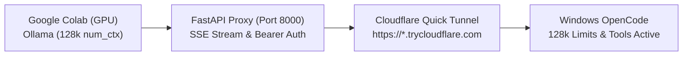

# One-Go Setup Guide: Spark-X2.6-4B on Google Colab + OpenCode v2

This document provides the exact, proven setup procedure to get **Spark-X2.6-4B (Q4_K_M)** running on a Google Colab GPU runtime and connected into **OpenCode v2** on Windows with **128k context** and **tools enabled** in **one shot**.

---

## The Complete Pipeline



---

## Step 1: In Google Colab (Run Once per Session)

1. Open a new or existing notebook on [Google Colab](https://colab.research.google.com).
2. Ensure runtime has a GPU: **Runtime** -> **Change runtime type** -> **T4 GPU** (or A100/L4).
3. Paste and run the following single cell (also saved in [`COLAB_SETUP.py`](file:///F:/MyProject/Spark_Working_Solution/COLAB_SETUP.py)):

```python
import subprocess
import sys
import os
import time
import re
import urllib.request
import requests

import secrets
API_KEY = os.environ.get("COLAB_API_KEY", secrets.token_urlsafe(32))
MODEL_ID = "SparkLLM/Spark-X2.6-4B:q4_k_m"

print("1. Installing system dependencies & packages...")
subprocess.run("sudo apt-get update -qq && sudo apt-get install -y -qq zstd", shell=True, check=True)
subprocess.run([sys.executable, "-m", "pip", "install", "-q", "fastapi", "uvicorn", "httpx"], check=True)

print("2. Terminating stale processes...")
subprocess.run("pkill -9 -f uvicorn || true", shell=True)
subprocess.run("pkill -9 -f ollama || true", shell=True)
subprocess.run("pkill -9 -f cloudflared || true", shell=True)
time.sleep(2)

print("3. Installing Ollama...")
subprocess.run("curl -fsSL https://ollama.com/install.sh | sh", shell=True, check=True)

print("4. Launching Ollama daemon with GPU optimizations...")
ollama_env = os.environ.copy()
ollama_env["OLLAMA_HOST"] = "127.0.0.1:11434"
ollama_env["OLLAMA_FLASH_ATTENTION"] = "1"
ollama_env["OLLAMA_KV_CACHE_TYPE"] = "q4_0"
ollama_env["OLLAMA_NUM_PARALLEL"] = "1"
ollama_env["OLLAMA_NUM_CTX"] = "131072"

ollama_log = open("/content/ollama.log", "w")
subprocess.Popen(["ollama", "serve"], stdout=ollama_log, stderr=subprocess.STDOUT, env=ollama_env)

for _ in range(30):
    try:
        if requests.get("http://127.0.0.1:11434/api/tags", timeout=2).ok:
            print("Ollama daemon online!")
            break
    except Exception:
        pass
    time.sleep(1)
else:
    raise RuntimeError("Ollama failed to start in time.")

print(f"5. Downloading model weights: {MODEL_ID} (~3.5 GB)...")
subprocess.run(["ollama", "pull", MODEL_ID], check=True)

print("6. Baking 128k (131072) context limit directly into Ollama model definition...")
modelfile_content = f"FROM {MODEL_ID}\nPARAMETER num_ctx 131072\n"
with open("/content/Modelfile", "w") as f:
    f.write(modelfile_content)
subprocess.run(["ollama", "create", MODEL_ID, "-f", "/content/Modelfile"], check=True)

print("7. Writing FastAPI OpenAI translation proxy...")
proxy_code = f'''
import os, json, httpx
from fastapi import FastAPI, Request, HTTPException
from fastapi.responses import StreamingResponse, Response

OLLAMA_BASE = "http://127.0.0.1:11434"
API_KEY = "{API_KEY}"
MODEL_ID = "{MODEL_ID}"

app = FastAPI()
client = httpx.AsyncClient(timeout=600.0)

def verify_auth(request: Request):
    auth = request.headers.get("authorization", "")
    if not auth.startswith("Bearer "):
        raise HTTPException(status_code=401, detail="Missing Bearer token")
    if auth.split("Bearer ", 1)[1].strip() != API_KEY:
        raise HTTPException(status_code=403, detail="Invalid API key")

@app.get("/v1/models")
async def list_models(request: Request):
    verify_auth(request)
    return {{"object": "list", "data": [{{"id": MODEL_ID, "object": "model", "created": 1677610143, "owned_by": "ollama"}}]}}

def translate_sse_chunk(line: str) -> str:
    if not line.startswith("data: "): return line
    payload = line[6:].strip()
    if payload == "[DONE]": return line
    try:
        obj = json.loads(payload)
        choices = obj.get("choices")
        if isinstance(choices, list) and choices:
            delta = choices[0].get("delta")
            if isinstance(delta, dict):
                reasoning = delta.get("reasoning")
                content = delta.get("content")
                if reasoning and not content:
                    delta["content"] = reasoning
                if "reasoning" in delta:
                    del delta["reasoning"]
        return "data: " + json.dumps(obj, ensure_ascii=False)
    except Exception:
        return line

async def sse_stream_generator(upstream_response):
    buffer = b""
    async for chunk in upstream_response.aiter_bytes():
        buffer += chunk
        while b"\\n" in buffer:
            line_bytes, buffer = buffer.split(b"\\n", 1)
            line = line_bytes.decode("utf-8", errors="replace").rstrip("\\r")
            if not line:
                yield b"\\n"
                continue
            yield (translate_sse_chunk(line) + "\\n").encode("utf-8")
    if buffer:
        line = buffer.decode("utf-8", errors="replace").rstrip("\\r")
        if line:
            yield (translate_sse_chunk(line) + "\\n\\n").encode("utf-8")

@app.api_route("/{{path:path}}", methods=["GET", "POST", "PUT", "PATCH", "DELETE", "OPTIONS"])
async def proxy_all(path: str, request: Request):
    if request.method == "OPTIONS":
        return Response(status_code=200, headers={{"Access-Control-Allow-Origin": "*", "Access-Control-Allow-Methods": "*", "Access-Control-Allow-Headers": "*"}})
    verify_auth(request)
    if not path.startswith("v1/"):
        raise HTTPException(status_code=404, detail="Only /v1 endpoints are exposed")
    target = f"{{OLLAMA_BASE}}/{{path}}"
    if request.url.query:
        target += "?" + request.url.query
    body_bytes = await request.body()
    is_stream = False
    if request.method == "POST" and path == "v1/chat/completions":
        try:
            payload = json.loads(body_bytes.decode("utf-8"))
            payload["model"] = MODEL_ID
            options = payload.get("options", {{}})
            options["num_ctx"] = 131072
            payload["options"] = options
            is_stream = bool(payload.get("stream", False))
            body_bytes = json.dumps(payload).encode("utf-8")
        except Exception:
            pass
    headers = {{"Content-Type": "application/json", "Accept": request.headers.get("accept", "*/*")}}
    req = client.build_request(request.method, target, headers=headers, content=body_bytes)
    upstream = await client.send(req, stream=is_stream)
    if is_stream:
        return StreamingResponse(sse_stream_generator(upstream), status_code=upstream.status_code, headers={{"Content-Type": "text/event-stream; charset=utf-8", "Cache-Control": "no-cache", "Connection": "keep-alive"}})
    else:
        resp_body = await upstream.aread()
        try:
            data = json.loads(resp_body.decode("utf-8"))
            if "choices" in data and len(data["choices"]) > 0:
                msg = data["choices"][0].get("message", {{}})
                if "reasoning" in msg and not msg.get("content"):
                    msg["content"] = msg["reasoning"]
            resp_body = json.dumps(data).encode("utf-8")
        except Exception:
            pass
        return Response(content=resp_body, status_code=upstream.status_code, headers={{"Content-Type": "application/json"}})
'''

with open("/content/proxy.py", "w") as f:
    f.write(proxy_code.strip())

print("8. Launching FastAPI server on port 8000...")
proxy_log = open("/content/proxy.log", "w")
subprocess.Popen(["uvicorn", "proxy:app", "--host", "0.0.0.0", "--port", "8000"], stdout=proxy_log, stderr=subprocess.STDOUT)

for _ in range(15):
    try:
        if requests.get("http://127.0.0.1:8000/v1/models", headers={"Authorization": f"Bearer {API_KEY}"}, timeout=2).ok:
            print("FastAPI proxy verified!")
            break
    except Exception:
        pass
    time.sleep(1)
else:
    raise RuntimeError("FastAPI proxy failed to start.")

print("9. Creating Cloudflare HTTPS tunnel...")
if not os.path.exists("/content/cloudflared"):
    urllib.request.urlretrieve("https://github.com/cloudflare/cloudflared/releases/latest/download/cloudflared-linux-amd64", "/content/cloudflared")
    subprocess.run("chmod +x /content/cloudflared", shell=True, check=True)

tunnel_log_path = "/content/cloudflared.log"
subprocess.Popen(["/content/cloudflared", "tunnel", "--url", "http://127.0.0.1:8000", "--no-autoupdate"], stdout=open(tunnel_log_path, "w"), stderr=subprocess.STDOUT)

tunnel_url = None
for _ in range(30):
    time.sleep(2)
    if os.path.exists(tunnel_log_path):
        with open(tunnel_log_path) as f:
            match = re.search(r'https://[a-zA-Z0-9-]+\.trycloudflare\.com', f.read())
            if match:
                tunnel_url = match.group(0)
                break

if not tunnel_url:
    raise RuntimeError("Tunnel failed to start.")

print("\n" + "="*60)
print("             COLAB BACKEND READY")
print("="*60)
print(f"Tunnel Public URL : {tunnel_url}")
print(f"Base URL          : {tunnel_url}/v1")
print(f"API Bearer Key    : {API_KEY}")
print(f"Model ID          : {MODEL_ID}")
print("="*60)
```

4. In ~1 minute, it will print the block:
   ```text
   ============================================================
                COLAB BACKEND READY
   ============================================================
   Tunnel Public URL : https://xyz-abc.trycloudflare.com
   Base URL          : https://xyz-abc.trycloudflare.com/v1
   API Bearer Key    : <YOUR_GENERATED_API_KEY>
   Model ID          : SparkLLM/Spark-X2.6-4B:q4_k_m
   ============================================================
   ```
5. **Copy the `Tunnel Public URL`**.

---

## Step 2: On Windows (Single Command)

Open **PowerShell** and run this single command (replace with your printed tunnel URL):

```powershell
powershell -ExecutionPolicy Bypass -File ".\Apply-Colab-Tunnel.ps1" -TunnelUrl "https://xyz-abc.trycloudflare.com" -ApiKey "<YOUR_GENERATED_API_KEY>"
```

### What this command does automatically:
1. Writes the configuration to **both**:
   - `~/.config/opencode/opencode.jsonc` (global OpenCode config)
   - `opencode.jsonc` in your current project folder
2. Sets **`context: 131072`** and **`output: 131072`** (128k context).
3. Sets **`tools: true`** and timeout safety margins.
4. Executes **`opencode reload`** to make changes active instantly.
5. Runs a live check against the tunnel to confirm everything works.

---

## Step 3: Use OpenCode

In your terminal or launcher, run:
```powershell
opencode
```
Select model **`colab/spark`**. You now have full 128k context, tool use, and streaming enabled.

---

## Summary of the 4 Critical Fixes Built Into This Setup

| Problem Solved | The Fix Included |
|---|---|
| **Cloudflare Error 530** | Step 8 starts `uvicorn proxy:app --port 8000` in the background *before* `cloudflared` starts. |
| **Context Error > 4096** | Step 6 runs `ollama create ... PARAMETER num_ctx 131072` to bake the 128k context limit into the model manifest. |
| **Broken SSE Streaming** | `sse_stream_generator` properly preserves `\n\n` event boundaries and maps `<reasoning>` to `content`. |
| **Wrong OpenCode Config** | The PowerShell script updates `~/.config/opencode/opencode.jsonc` where OpenCode actually reads its settings. |
